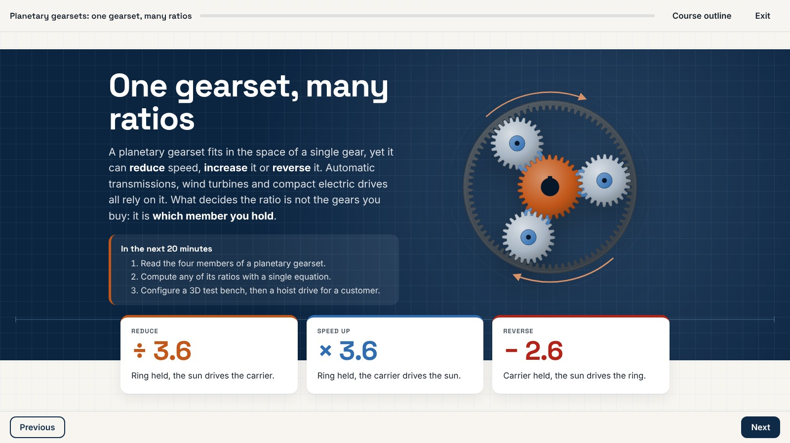

# Elabora core

**An open e-learning format that AI agents write and people review, with a validator, a SCORM 1.2 compiler tested against documented LMS behaviour, and a contract that keeps custom code testable.**

[](https://github.com/aureliendossantos/elabora-core/actions/workflows/ci.yml) [](LICENSE) 



Elabora core takes a module from the plan a client validated to a compliant SCORM package and its proof dossier, without a proprietary editor. A course is a folder of plain files: agents write it, people read and edit it, and every tool, the [Elabora desktop app](https://elabora.studio) included, works on the same files.

## What it does

- **An open format.** A plan that is the client's contract, screens of schema-checked blocks, components, themes and free objects, all in JSON, CSS and templates without code. [Specification](SPEC.md)
- **Checks with stable codes.** Plan coverage, item writing, feedback, accessibility, LMS budgets: every finding has a code agents can branch on and a fix people can follow. [Diagnostic codes](docs/diagnostics.md)
- **Deterministic builds.** The same sources give the same bytes: a SCORM 1.2 package, or a module for a plain web server, with a proof dossier of plan coverage, tracking, accessibility and the human checks left to do. [Delivery](docs/delivery-scorm12.md)
- **Tested against LMS behaviour.** Eleven executable LMS profiles and an emulator that replays their launch topologies, abrupt closes and resume. [LMS profiles](docs/lms-profiles.md)
- **Custom code that stays governed.** three.js scenes and mini-games run sandboxed, with a manifest, tests and props editable without code. [Free-object contract](docs/free-object-contract.md)
- **Built for agents.** The same journaled, undoable operations as MCP tools or shell calls, short skills, and rules shipped with every course. [Working with an agent](docs/agents.md)

## Try it

```bash
git clone https://github.com/aureliendossantos/elabora-core.git && cd elabora-core
pnpm install
node bin/elabora.js validate examples/diagnostic-reseau --profile moodle
node bin/elabora.js build examples/diagnostic-reseau --profile moodle
node bin/elabora.js preview examples/diagnostic-reseau
```

Node 24 or later runs the TypeScript sources directly; a checkout installs with pnpm 11 (`npm install -g pnpm`). Media need ffmpeg, previews and LMS tests a browser: [Getting started](docs/getting-started.md) says which, and walks through the samples.

## Use it with an agent

```bash
node bin/elabora.js mcp examples/diagnostic-reseau     # an MCP server on stdio, scoped to one course
node bin/elabora.js tools list --json                  # or the same operations from a shell
```

Agents start with `elabora_overview`, follow the course's `AGENTS.md` and load the skills the server serves. Writes are journaled: `elabora undo --batch` takes back a whole batch of AI work and keeps what people edited since. Versions of the plan, the client's validation, publishing and paid services stay with people. [Agent tools](docs/mcp-tools.md)

## How a course is made

```
plan.json            the contract: objectives, items, texts kept word for word (versions V1, V2… in plan-versions/)
   │ covers, textRef, questionRef
screens/*.json       blocks and events: agents assemble, people edit values, every value schema-checked
   │ block types and layouts
components/<id>/     templates without code, a props schema and a fallback to native blocks
   │ free-object blocks
objects/<id>/        governed code: manifest, tests and notes, sandboxed; authors edit declared props only
   │ elabora build: validate, compile, proof dossier
dist/*.zip           elabora test (LMS emulator), then the client's LMS
```

## Documentation

| To… | Read |
|---|---|
| understand the format | [Specification](SPEC.md) · [Built-in blocks](docs/blocks.md) · [Components](docs/components.md) · [Design layer](docs/design.md) |
| author with an agent | [Working with an agent](docs/agents.md) · [Agent tools](docs/mcp-tools.md) · [Command line](docs/cli.md) |
| deliver to an LMS or the web | [SCORM 1.2 and the emulator](docs/delivery-scorm12.md) · [LMS profiles](docs/lms-profiles.md) · [Web target](docs/delivery-web.md) |
| change the code | [Contributing](CONTRIBUTING.md) · [Architecture](docs/architecture.md) · [Decisions](docs/decisions.md) |

The whole map is [`docs/index.md`](docs/index.md), also published at [elabora.studio/en/docs/developers](https://elabora.studio/en/docs/developers/).

## Packages

pnpm workspaces, TypeScript in strict mode:

| Package | Role |
|---|---|
| [`@elabora/format`](packages/format/) | The normative JSON Schemas, generated types, the schema registry |
| [`@elabora/player`](packages/player/) | The browser runtime shipped in every package |
| [`@elabora/fonts`](packages/fonts/) | The vetted free fonts courses embed, with their licences |
| [`@elabora/core`](packages/core/) | Logic without I/O: project model, validation, components, compilation, operations, migrations |
| [`@elabora/node`](packages/node/) | Files, journal and undo, builds and packaging, media, backups, library, LMS emulator, object gates, captures |
| [`@elabora/engine`](packages/engine/) | The editing session the desktop app runs on |
| [`@elabora/cli`](packages/cli/) | The `elabora` command line, the MCP server and the skills |

## Status

Version 0.1, October 2026, format `elabora/0.1`. SCORM 1.2 and a web target; no cmi5 or xAPI yet; Storyline and Rise imports in beta. [What 0.1 does not do yet](docs/getting-started.md#what-01-does-not-do-yet) · [Changelog](CHANGELOG.md)

## Licence

Code, specification, schemas and documentation: Apache-2.0 ([`LICENSE`](LICENSE)). The original content of the sample courses in [`examples/`](examples/) is CC0 1.0; each example's `LICENSE.md` lists the third-party items that keep their own licence. three.js r186 is vendored under the MIT licence ([`packages/node/vendor/three-LICENSE.txt`](packages/node/vendor/three-LICENSE.txt)). See [D44](docs/decisions/D44.md).
