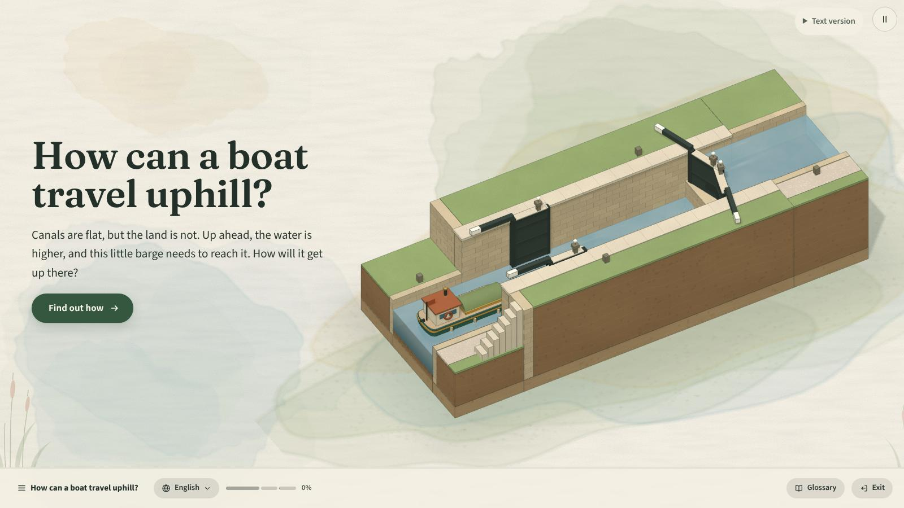

# Elabora core

**The open core of Elabora, an e-learning authoring tool where AI agents are co-authors.** A course is a folder of plain files. Agents write it, people review it, and Elabora checks it and builds a package for your LMS, in the format that suits it.

[](https://github.com/aureliendossantos/elabora-core/actions/workflows/ci.yml) [](LICENSE) 



*The canal-locks sample course, rendered by `elabora look` at 1600×900.*

Elabora is in early beta. This repository holds the course format, the validator, the renderer, the `elabora` command line and the MCP server for agents. The [Elabora desktop app](https://elabora.studio) runs on it and works on the same files.

## Try it

You need Node 24 and pnpm 11 (`npm install -g pnpm`).

```bash
git clone https://github.com/aureliendossantos/elabora-core.git && cd elabora-core
pnpm install
node bin/elabora.js validate examples/canal-locks
node bin/elabora.js build examples/canal-locks
node bin/elabora.js preview examples/canal-locks
```

`build` writes a SCORM 1.2 package (the format every LMS takes, when the course names no LMS) and its proof dossier to `examples/canal-locks/dist/`. `preview` prints a local address: open it to play the course, alone or in the LMS emulator. It rebuilds the course when a file changes.

Media need ffmpeg. Previews, looks and LMS tests need Chrome, Edge or Chromium. [Getting started](docs/getting-started.md) has the details and walks through the samples.

## What it does

- **An open format.** A plan, screens of blocks, components, themes and free objects, in JSON, CSS and templates. Every value is checked against a schema. [Specification](SPEC.md)
- **Checks with stable codes.** Plan coverage, questions, feedback, accessibility, LMS limits. Each finding has a code agents can act on and a fix people can follow. [Diagnostic codes](docs/diagnostics.md)
- **Same sources, same bytes.** A build gives a package for the LMS, in the format Elabora picks for it (SCORM 1.2 or SCORM 2004), or a module for any web server, with a proof dossier: plan coverage, tracking, accessibility, and the checks left to people. [Delivery formats](docs/delivery.md)
- **Tested against real LMS behaviour.** Eleven LMS profiles and an emulator that replays their launch modes, abrupt closes and resume. [LMS profiles](docs/lms-profiles.md)
- **Custom code, kept safe.** three.js scenes and mini-games run sandboxed, with a manifest, tests and settings authors edit without code. [Free-object contract](docs/free-object-contract.md)
- **Made for agents.** Every edit is journaled and can be undone, from MCP tools or the shell. Short skills and rules ship with every course. [Working with an agent](docs/agents.md)

## Use it with an agent

Start an MCP server for one course:

```bash
node bin/elabora.js mcp examples/canal-locks
```

Or call the same operations from a shell:

```bash
node bin/elabora.js tools list
```

A coding agent such as Claude Code or Codex needs nothing more. Open it in a course folder: it reads the course's `AGENTS.md` and runs `elabora`. For Claude Desktop, the [extension](plugins/README.md) connects the server to the courses you pick.

Agents start with the `elabora_overview` tool. Their edits are grouped in batches: `elabora undo --batch` takes back a whole batch and keeps what people changed since. Plan versions, client approval, publishing and paid services stay with people. [Agent tools](docs/mcp-tools.md)

## How a course is made

```
plan.json            the contract: objectives, items, texts kept word for word
   │ covers, textRef, questionRef
screens/*.json       blocks and events: agents assemble them, people edit the values
   │ block types and layouts
components/<id>/     templates and a props schema, with a fallback to built-in blocks
   │ free-object blocks
objects/<id>/        custom code with a manifest, tests and notes, sandboxed
   │ elabora build: validate, compile, write the proof dossier
dist/*.zip           elabora test runs it in the LMS emulator, then it goes to the client's LMS
```

## Documentation

| To… | Read |
|---|---|
| learn the format | [Specification](SPEC.md) · [Built-in blocks](docs/blocks.md) · [Components](docs/components.md) · [Design layer](docs/design.md) |
| write with an agent | [Working with an agent](docs/agents.md) · [Agent tools](docs/mcp-tools.md) · [Command line](docs/cli.md) |
| deliver to an LMS or the web | [Delivery formats](docs/delivery.md) · [SCORM 1.2 and the emulator](docs/delivery-scorm12.md) · [SCORM 2004](docs/delivery-scorm2004.md) · [LMS profiles](docs/lms-profiles.md) · [Web target](docs/delivery-web.md) |
| change the code | [Contributing](CONTRIBUTING.md) · [Architecture](docs/architecture.md) · [Decisions](docs/decisions.md) |

[`docs/index.md`](docs/index.md) maps every page. The site renders the same pages at [elabora.studio/en/docs/developers](https://elabora.studio/en/docs/developers/).

## Packages

A pnpm workspace in strict TypeScript:

| Package | Role |
|---|---|
| [`@elabora/format`](packages/format/) | JSON Schemas of the format, generated types, schema registry |
| [`@elabora/player`](packages/player/) | The browser runtime shipped in every package |
| [`@elabora/fonts`](packages/fonts/) | Free fonts courses embed, with their licences |
| [`@elabora/core`](packages/core/) | Logic without I/O: project model, validation, components, compilation, edits, migrations |
| [`@elabora/node`](packages/node/) | Files, journal and undo, builds, media, backups, library, LMS emulator, captures |
| [`@elabora/engine`](packages/engine/) | The editing session of the desktop app |
| [`@elabora/cli`](packages/cli/) | The `elabora` command line, the MCP server and the skills |

## Status

Version 0.1, October 2026, format `elabora/0.1`. Targets: SCORM 1.2, SCORM 2004 and the web. Storyline and Rise imports are in beta. [Limits of 0.1](docs/getting-started.md#what-01-does-not-do-yet) · [Changelog](CHANGELOG.md)

## Licence

- **Code, specification, schemas and docs:** Apache-2.0 ([`LICENSE`](LICENSE)).
- **Sample courses** in [`examples/`](examples/) **and module templates** in [`templates/`](templates/): their original content is CC0 1.0. Each one's `LICENSE.md` lists what keeps its own licence, such as fonts under the SIL OFL.
- **Bundled components:** three.js r186 (MIT), fonts (SIL OFL 1.1), voices and sounds (CC0, one voice CC-BY 4.0). [`NOTICE`](NOTICE) lists them with their sources.
- **ffmpeg** is used, not bundled: Elabora runs the copy on your system. Its builds are LGPL or GPL.

See [D44](docs/decisions/D44.md) for the reasons.
